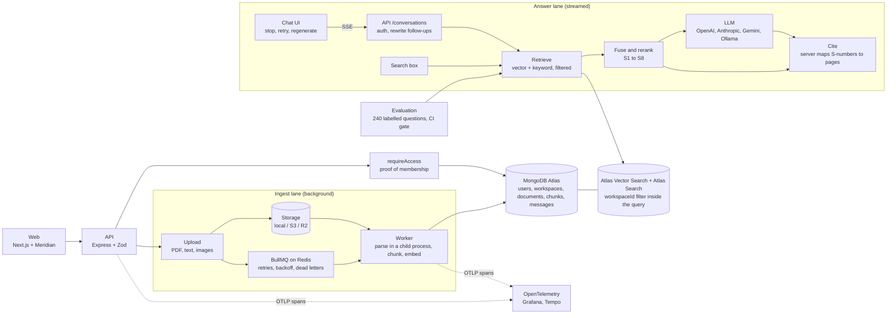

# Atlas AI

A private knowledge copilot: upload your documents, ask questions, and get streamed answers with citations you can
check. Built by [Yashwanth Varma](https://github.com/yashwanthvarma74-ai) on the
[Meridian design system](https://github.com/yashwanthvarma74-ai/designSystem).

> **Demo video: not recorded yet.** The 90-second script is in [docs/DEMO-SCRIPT.md](docs/DEMO-SCRIPT.md).

## Live demo

**<https://atlas-ai-seven-vert.vercel.app>**. Press **Continue as guest**: no sign-up, and you land in a workspace you
own. It is a demo, so nothing is kept: reloading the page empties your workspace, everyone's documents and
conversations are deleted after three hours, and guest accounts after 24.

It runs on free tiers (Vercel, Render, MongoDB Atlas, Upstash, Supabase Storage), so the first visit after a quiet spell
waits up to a minute for the API to wake. Retrieval and answers use whichever embedder and model the deployment is
configured with; with the offline defaults an answer is the best passages quoted back, not written prose. Read the
[benchmarks](docs/BENCHMARKS.md) before quoting a number.

## Architecture



Everything that touches a workspace's data goes through `requireAccess`
([ADR 0001](docs/adr/0001-workspace-access-is-proved-by-a-type.md)). Chunks and their vectors are stored with their
`workspaceId`, and the search indexes filter on it inside the query.

**How a question becomes a cited answer**

1. The UI shows your message instantly and opens a Server-Sent Events stream.
2. The API rewrites a follow-up ("what about 2025?") into a standalone question.
3. Hybrid retrieval runs vector and keyword search with a `workspaceId` filter that server code adds, never the model.
4. Results are merged with reciprocal rank fusion, reranked and numbered S1 to S8.
5. The model answers from those sources only and cites them by number while tokens stream to the browser.
6. The server maps each number to its stored page and passage, drops unknown ones, and logs tokens, latency and cost.

**From upload to indexed**

1. The API checks the caller's editor role, reads the first bytes to decide what the file is, stores it, records the
   document as `queued` and queues a job. It answers `202`.
2. The worker re-checks that the uploader still has access, then parses the file page by page in a child process
   that holds none of the worker's credentials.
3. Each page is split at paragraph, sentence and word boundaries into chunks that never cross a page.
4. The chunks are embedded in batches and stored with their page, workspace and vector. The document becomes
   `indexed`, or `failed` with a reason the user can act on.

## Key decisions

- [0001. Workspace access is proved by a type, not remembered by each route](docs/adr/0001-workspace-access-is-proved-by-a-type.md)
- [0002. Build the UI with the design system](docs/adr/0002-build-the-ui-with-the-design-system.md)
- [0003. Accounts, sessions and guests](docs/adr/0003-accounts-and-sessions.md)
- [0004. Ingest is a queue of idempotent jobs](docs/adr/0004-ingest-is-a-queue-of-idempotent-jobs.md)
- [0005. Chunking by structure, with a little overlap](docs/adr/0005-chunking-by-structure-with-overlap.md)
- [0006. Uploads are untrusted bytes](docs/adr/0006-uploads-are-untrusted-bytes.md)
- [0007. Atlas Vector Search and Atlas Search, developed on Atlas Local](docs/adr/0007-atlas-search-on-atlas-local.md)
- [0008. Hybrid retrieval, and a tenant filter that is tested at every layer](docs/adr/0008-hybrid-retrieval-and-the-tenant-filter.md)
- [0009. Citations are owned by the server](docs/adr/0009-citations-are-owned-by-the-server.md)
- [0010. Answers stream over Server-Sent Events, and Stop means "save what you have"](docs/adr/0010-answers-stream-over-sse-and-stop-means-save.md)
- [0011. Conversations are private until their author shares them](docs/adr/0011-conversations-are-private-until-shared.md)
- [0012. The model is behind an interface, and everything it sees or says is untrusted](docs/adr/0012-the-model-is-behind-an-interface-and-everything-it-sees-or-says-is-untrusted.md)
- [0013. Quality is a number, and a change that lowers it does not merge](docs/adr/0013-quality-is-a-number-and-a-gate.md)
- [0014. The assistant proposes, and a person approves](docs/adr/0014-the-assistant-proposes-and-a-person-approves.md)
- [0015. Containers, and the hardening that came with them](docs/adr/0015-containers-and-hardening.md)
- [0016. Traces from spans, and a parser in its own process](docs/adr/0016-traces-and-an-isolated-parser.md)

## Benchmarks and how to reproduce them

Hardware: Apple M4 Pro, 14 cores, 24 GB, macOS, Node 22, MongoDB Atlas Local 8, Redis 8. Dataset: 30 generated
documents (325 passages) and 240 questions, half in the document's words and half paraphrased, generated from a fixed
seed so the labels are exact. Models for these runs: the offline hash embedder and the offline extractive answerer, so
the numbers measure retrieval and the system, not a language model. Full tables and the method are in
[docs/BENCHMARKS.md](docs/BENCHMARKS.md) and [docs/EVALUATION.md](docs/EVALUATION.md).

| Measure                              | Result                                                       | Target            | Reproduce                                                 |
| ------------------------------------ | ------------------------------------------------------------ | ----------------- | --------------------------------------------------------- |
| Recall@10                            | **89.2%** (92.5% same words, 85.8% paraphrased)              | 0.90, **not met** | `npm run eval`                                            |
| Cross-workspace retrievals           | **0**, with each search stage attacked on its own            | 0, met            | `npm run eval`, `isolation.test.ts`                       |
| Citation consistency                 | 100% of 480 citations (an answerer that only quotes)         | 95%+              | `npm run eval`                                            |
| Search, 10 in flight                 | p50 7.4 ms, p95 9.5 ms, p99 11.6 ms                          |                   | k6, `infra/k6/atlas.js`                                   |
| Chat, 10 in flight (offline model)   | p50 11.8 ms, p95 18.5 ms, p99 20.8 ms; 0.00% errors          |                   | k6, `infra/k6/atlas.js`                                   |
| Time to first word, hosted providers | **not measured**: no hosted model has been benchmarked       | published         | `npm run eval` with a real `LLM_PROVIDER`                 |
| Cost per answer                      | $0 for the offline model; recorded on every real answer      | measured          | the evaluation page                                       |
| Query plans                          | every filtered or sorted query uses an index, no memory sort |                   | `npm run explain`, [EXPLAIN-PLANS](docs/EXPLAIN-PLANS.md) |
| Lighthouse, landing and sign-in      | performance 100, accessibility 100, LCP 0.5 s, CLS 0         | budgets enforced  | `npm run lighthouse`                                      |
| Web bundle                           | 347 kB gzipped                                               | 400 kB budget     | `npm run size -w @atlas/web`                              |

Honest limits: the 0.90 recall target is missed; the numbers above come from the offline embedder, which matches on
shared words and not meaning, and will change with a real one. The citation number means little for a model that
only quotes. Lighthouse measured two routes (the pages that need no sign-in), on localhost.

## Failure modes

What happens when something underneath breaks. Each is a deliberate choice, and the ones with tests name them.

| What fails                           | What happens                                                                                                                                                                      |
| ------------------------------------ | --------------------------------------------------------------------------------------------------------------------------------------------------------------------------------- |
| Redis is down                        | The API starts and answers; an upload fails fast with "try again" instead of queueing into the void, and chat is unaffected. A sweep re-queues documents saved while it was away. |
| The queue loses a job                | A sweep re-queues any document stuck in `queued`. Jobs are idempotent, so a duplicate does no harm.                                                                               |
| The parser crashes or hangs          | It runs in a child process that is killed on a timeout; the document is marked `failed` with a reason and the worker carries on.                                                  |
| The embedding service is down        | Ingest retries with backoff, then keeps the job as a dead letter and tells the person. Search says the embedding service is unavailable instead of returning nothing.             |
| The model provider is slow or down   | The first word has 30 seconds and the whole answer two minutes; then the answer is saved as `failed` with a reason and **Retry** is offered. Stop saves what had arrived.         |
| The browser disconnects mid-answer   | The connection closing aborts the call to the provider and saves the partial answer as `stopped`.                                                                                 |
| Atlas Search is not available        | Uploading and indexing still work; searching is refused with a clear message, and the app checks again every ten seconds without a restart.                                       |
| A document tells the model to act    | A tool call is only a proposal: validated, shown to a person with its exact arguments, run once by the conversation's author, and audited ([RED-TEAM](docs/RED-TEAM.md)).         |
| Two answers race in one conversation | A unique index allows one streaming answer per conversation; the second request gets a 409.                                                                                       |

## Run it locally

You need Node 22+ and Docker. `docker compose up -d` starts MongoDB with Atlas Search and Vector Search (the
`mongodb-atlas-local` image, on port 27018) and Redis. If you already run Redis on 6379, start it with
`REDIS_PORT=6390 docker compose up -d`.

```bash
cp .env.example .env
npm install
docker compose up -d
npm run seed     # a demo account and 30 documents; it prints the sign-in details
npm run dev      # web http://localhost:3002, API http://localhost:4002, and the ingest worker
```

Everything in containers, with no Node needed:

```bash
JWT_SECRET=$(openssl rand -base64 48) docker compose --profile app up --build
```

Add traces and a Grafana dashboard (open <http://localhost:3000>, folder "Atlas AI"):

```bash
OTEL_EXPORTER_OTLP_ENDPOINT=http://grafana:4318 JWT_SECRET=$(openssl rand -base64 48) \
  docker compose --profile app --profile observability up --build
```

Real models. The offline defaults need no key. For semantic search and written answers, set the providers in `.env`:
`EMBEDDING_PROVIDER` is `ollama`, `openai`, `voyage` or `gemini`; `LLM_PROVIDER` is `ollama`, `openai`, `anthropic` or
`gemini`. A different embedder means a different vector size, so `EMBEDDING_DIMENSIONS` changes with it and the
vector index is rebuilt (the app refuses to start rather than mix sizes).

```bash
npm test                  # unit, integration and component tests (needs MongoDB with Atlas Search)
npm run test:coverage     # core and API, with the 85% floor on core
npm run lint && npm run typecheck
npm run eval              # the retrieval benchmark and its gate
npm run explain           # query plans for every filtered or sorted query
npm run e2e               # Playwright against the containers (start them first)
npm run lighthouse        # Lighthouse budgets against the containers
```

Load test, with k6, against a running API:
`docker run --rm -i -v "$PWD:/work" -w /work/infra/k6 -e BASE_URL=http://host.docker.internal:4002 grafana/k6 run atlas.js`.

## What changes at 10x and 100x

- **10x (hundreds of users, thousands of documents).** One Node process saturates first; the k6 numbers show latency
  growing in proportion once 50 requests are in flight. Run the API and the worker as separate services with several
  API replicas behind a load balancer (nothing in the API holds state), and parse in a pool of workers. The rate
  limiters keep their counts in each process and move to Redis at this point so replicas agree. Atlas M10 or larger
  replaces the free tier, with dedicated search nodes.
- **100x (millions of chunks).** Vector search becomes the cost. Quantised vectors and dedicated search nodes come
  first; filtering by workspace inside the query already keeps each search small. Embedding becomes a batch pipeline
  with its own budget and back-pressure, and the model call (not our code) dominates latency and cost, so
  per-workspace model routing and caching of repeated questions pay for themselves. Evaluation moves from a
  synthetic set to sampled real traffic with human labels.
- **What would not change.** The access type, the server-owned citations, the proposal-and-approval path for tools and
  the gate in CI scale with the code, not with the load.

## Threat model

Short version; the full table with the test behind each row is in [docs/THREAT-MODEL.md](docs/THREAT-MODEL.md).

| Threat                     | What could happen                                      | Defence                                                                                                                      |
| -------------------------- | ------------------------------------------------------ | ---------------------------------------------------------------------------------------------------------------------------- |
| Prompt injection in a file | A document tells the model to leak data or call a tool | Document text is data in a block it cannot close. Tools need schema checks, permission checks and approval outside the model |
| Cross-workspace leak       | Retrieval returns another customer's chunks            | `workspaceId` filter added by server code inside every vector and keyword query; an adversarial suite in CI                  |
| Malicious upload           | A crafted file crashes or exploits the parser          | Type from the bytes, size and page limits, parsing in a child process with no credentials, nothing executed                  |
| Runaway cost               | A user or bug burns through tokens                     | Rate limits, token caps, timeouts, cost recorded per answer                                                                  |
| Secret exposure            | API keys reach the browser or the prompt               | Keys only in server environment variables; request logs never contain headers                                                |

## Repository

```
atlas-ai/
├─ apps/
│  ├─ web/          Next.js frontend, built from @yashwanthvarma74/react
│  ├─ api/          Express API (and, on hosts with one service, the ingest worker)
│  ├─ worker/       BullMQ worker: parse, chunk, embed
│  └─ eval/         the benchmark, the CI gate, query plans, seed script
├─ packages/
│  ├─ shared/       types and Zod schemas used by both sides
│  └─ core/         access control, accounts, workspaces, documents, queue, parsing,
│                    chunking, embeddings, retrieval, chat, tools, tracing
├─ infra/           docker-compose, k6 load tests, Grafana dashboard
├─ e2e/             Playwright: end-to-end flows and accessibility
├─ docs/            ADRs, threat model, evaluation, benchmarks, SLOs, deploy, case study
└─ .github/         CI, deploy and Dependabot
```

More: [SLOs](docs/SLOS.md) · [case study](docs/case-study.md) · [deploying](docs/DEPLOY.md) ·
[red-team results](docs/RED-TEAM.md) · [resume bullet](docs/resume-bullet.md)

## Known limits

- No hosted model provider has been run against its live service in the benchmark, so nothing here measures one. Their
  request and stream formats are tested against fixtures in each provider's documented shape.
- Recall@10 is 89.2%, short of 0.90, on a benchmark answered by an embedder with no sense of meaning.
- No demo video yet.
- The Grafana dashboard's span, rate and error panels were checked against Tempo; its latency-percentile panels use
  TraceQL metrics, which depend on the collector's metrics generator and were not confirmed to draw in this setup.
