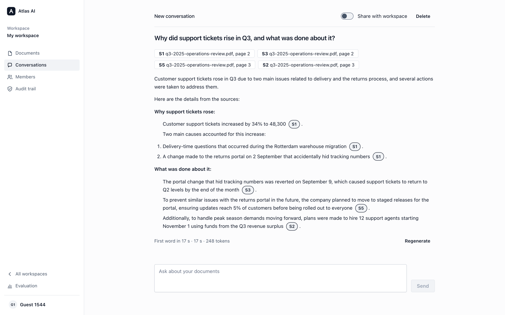
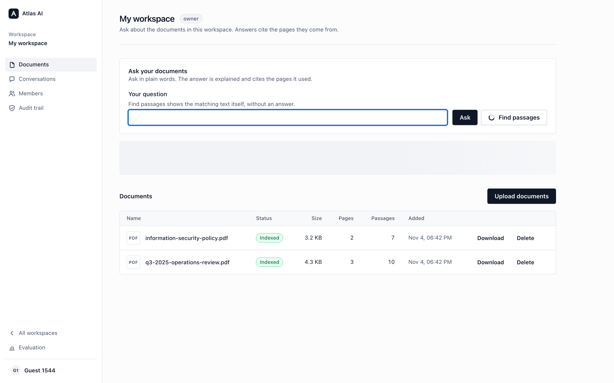
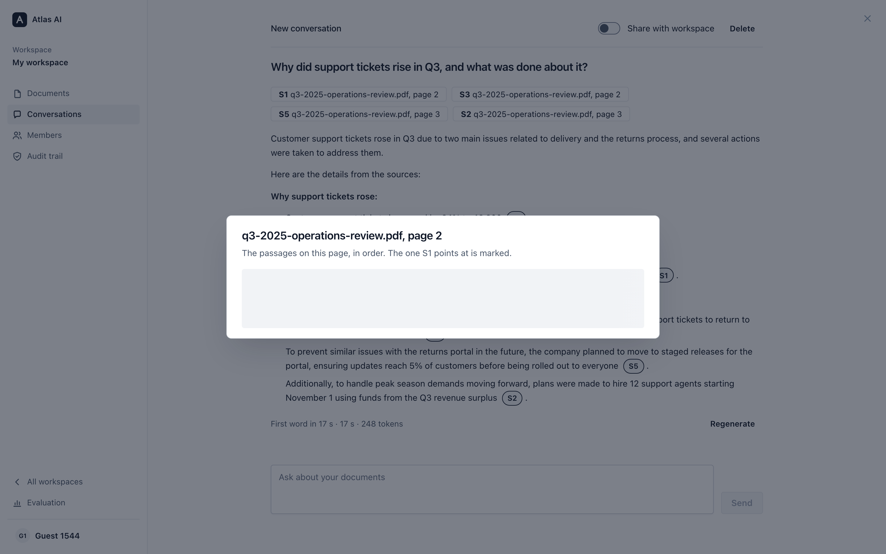
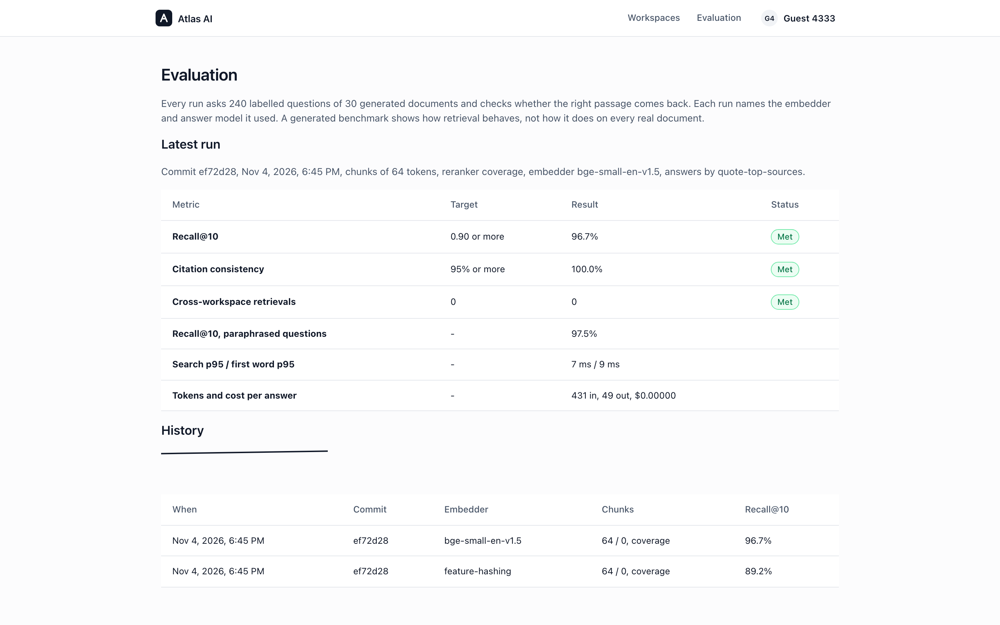
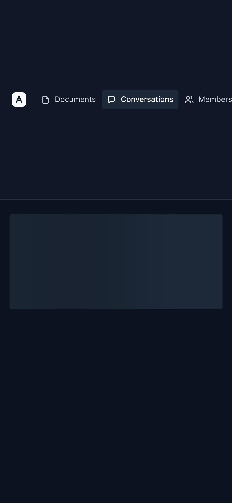
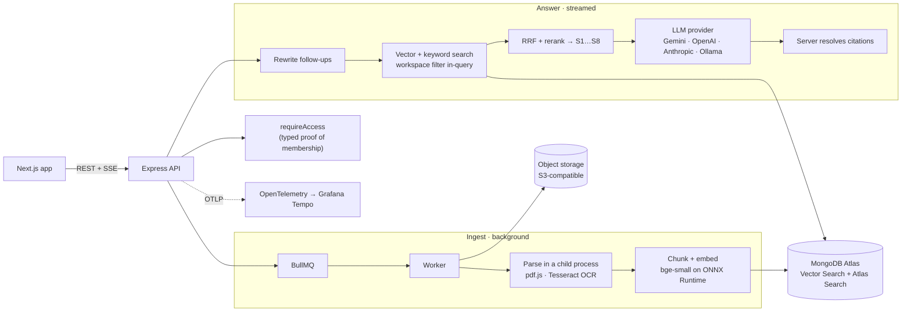

<div align="center">


# Atlas AI

**A private knowledge copilot. Ask your documents in plain words; every answer cites the page it came from.**

[](https://github.com/yashwanthvarma74-ai/Atlas-AI/actions/workflows/ci.yml)
[](docs/EVALUATION.md)
[](docs/THREAT-MODEL.md)
[](LICENSE)


[**Live demo**](https://atlas-ai-seven-vert.vercel.app) · [Architecture](#architecture) · [Evaluation](docs/EVALUATION.md) · [Decisions](docs/adr) · [Case study](docs/case-study.md)

</div>

<br />



## Overview

Atlas AI is a retrieval-augmented question-answering system for private documents. Upload PDFs, notes or scanned
images into a workspace; a background pipeline parses, chunks and embeds them. Ask a question and the answer streams
in, explained in plain language, with every claim linked to the exact page and passage it was taken from.

It is built to the standard of a production system rather than a demo: tenant isolation enforced inside every query,
citations the model cannot invent, a labelled benchmark that gates every change in CI, and tracing from request to
first token.

> **Live demo:** [atlas-ai-seven-vert.vercel.app](https://atlas-ai-seven-vert.vercel.app) → _Continue as guest_. It
> runs on free hosting with a tenth of a CPU core, so the first visit can take a minute to wake and a scanned image
> takes a minute or two to read. Guest data is cleared on reload and after three hours.

## Highlights

|                          |                                                                                                    |
| ------------------------ | -------------------------------------------------------------------------------------------------- |
| **Grounded answers**     | Sources are numbered by the server; the model cites numbers only, and unknown numbers are removed. |
| **Hybrid retrieval**     | Atlas Vector Search and Atlas Search, fused with reciprocal rank fusion and reranked.              |
| **Measured quality**     | Recall@10 **95.4%** on a 240-question benchmark, checked in CI on every push.                      |
| **Tenant isolation**     | The workspace filter lives inside each search stage; an adversarial suite attacks every layer.     |
| **Agent safety**         | The model can only _propose_ an action; a person approves it, and every call is audited.           |
| **Runs without a quota** | Embeddings run in-process on ONNX Runtime; OCR runs in an isolated child process.                  |
| **Accessible**           | Zero axe violations in end-to-end tests; Lighthouse 100 for performance and accessibility.         |

## Screenshots

<table>
  <tr>
    <td width="50%"><br /><sub><b>Workspace</b>: documents, their status, and the question box</sub></td>
    <td width="50%"><br /><sub><b>Citation</b>: the page a source came from, with the cited passage marked</sub></td>
  </tr>
  <tr>
    <td width="50%"><br /><sub><b>Evaluation</b>: every run against the targets, and its history</sub></td>
    <td width="50%" align="center"><br /><sub><b>Phone</b>, dark theme</sub></td>
  </tr>
</table>

## Architecture



<details>
<summary><b>How a question becomes a cited answer</b></summary>

1. The UI shows the question at once and opens a Server-Sent Events stream.
2. A follow-up ("and in 2025?") is rewritten into a standalone question.
3. Vector and keyword search run with a `workspaceId` filter that server code adds, never the model.
4. Results are fused with reciprocal rank fusion, reranked, and numbered S1 to S8.
5. The model answers from those sources only and cites them by number as tokens stream.
6. The server maps each number back to its page and passage, drops numbers it never issued, and records tokens,
   latency and cost.

</details>

<details>
<summary><b>From upload to indexed</b></summary>

1. The API checks the editor role, identifies the file from its bytes, stores it, and queues a job (`202 Accepted`).
2. The worker re-checks access, then parses page by page in a child process holding none of its credentials.
3. Pages are split at paragraph, sentence and word boundaries into chunks that never cross a page.
4. Chunks are embedded in batches and indexed. The document becomes `indexed`, or `failed` with a reason.

</details>

## Tech stack

| Layer         | Technology                                                                                                          |
| ------------- | ------------------------------------------------------------------------------------------------------------------- |
| Web           | Next.js 16, React 19, TanStack Query, [Meridian design system](https://github.com/yashwanthvarma74-ai/designSystem) |
| API           | Node.js 22, Express 5, Zod, hand-written Server-Sent Events                                                         |
| Ingest        | BullMQ on Redis, pdf.js, Tesseract.js, isolated child processes                                                     |
| Retrieval     | MongoDB Atlas Vector Search + Atlas Search, reciprocal rank fusion                                                  |
| Models        | bge-small-en-v1.5 on ONNX Runtime (in-process); Gemini, OpenAI, Anthropic, Ollama                                   |
| Observability | OpenTelemetry, Grafana and Tempo, Pino structured logs                                                              |
| Quality       | Vitest, fast-check, Playwright, axe, Lighthouse CI, k6, a custom eval harness                                       |
| Delivery      | Docker, GitHub Actions, Vercel, Render                                                                              |

## Getting started

Requires Node 22 and Docker.

```bash
git clone https://github.com/yashwanthvarma74-ai/Atlas-AI.git && cd Atlas-AI
cp .env.example .env
npm install
docker compose up -d          # MongoDB with Atlas Search, and Redis
npm run seed                  # a demo account with 30 documents
npm run dev                   # http://localhost:3002
```

Or run everything in containers: `JWT_SECRET=$(openssl rand -base64 48) docker compose --profile app up --build`.

Everything runs offline by default. Set `LLM_PROVIDER` (`gemini`, `openai`, `anthropic`, `ollama`) and its key in
`.env` for written answers; see [`.env.example`](.env.example).

| Command              | What it does                                                      |
| -------------------- | ----------------------------------------------------------------- |
| `npm test`           | Unit, integration and component tests (513)                       |
| `npm run eval`       | The retrieval benchmark and its quality gate                      |
| `npm run e2e`        | Playwright end-to-end and accessibility tests, against containers |
| `npm run lighthouse` | Lighthouse budgets                                                |
| `npm run explain`    | Query plans for every filtered or sorted query                    |

## Evaluation

Measured on a 240-question labelled benchmark over 30 documents, generated from a fixed seed so every label is exact.
Full method and tables in [EVALUATION.md](docs/EVALUATION.md) and [BENCHMARKS.md](docs/BENCHMARKS.md).

| Metric                       | Result                                 | Target |
| ---------------------------- | -------------------------------------- | ------ |
| Recall@10                    | **95.4%** (CI runner) · 96.7% (M4 Pro) | ≥ 0.90 |
| Recall@10, paraphrased       | 95.8%                                  |        |
| Cross-workspace retrievals   | **0**                                  | 0      |
| Search latency, 10 in flight | p95 9.5 ms                             |        |
| Lighthouse                   | 100 performance · 100 accessibility    |        |

<details>
<summary><b>Failure modes</b></summary>

| What fails                     | What happens                                                                                       |
| ------------------------------ | -------------------------------------------------------------------------------------------------- |
| Redis is down                  | Uploads fail fast with a clear message; chat keeps working. Stuck documents are re-queued later.   |
| A job is lost                  | A sweep re-queues documents stuck in `queued`; jobs are idempotent.                                |
| The parser crashes or hangs    | Its child process is killed on a timeout; the document fails with a reason and the worker goes on. |
| The embedding service is down  | Retries with backoff, then a dead letter and a message to the person.                              |
| The model is slow or busy      | Busy responses are retried; after 30 s with no first word the answer fails with **Retry** offered. |
| The browser disconnects        | The provider call is aborted and the partial answer is saved as `stopped`.                         |
| A document injects a tool call | It becomes a proposal a person must approve; it never runs on its own.                             |

</details>

<details>
<summary><b>What changes at 10× and 100×</b></summary>

- **10×**: run the API and worker as separate services with several API replicas (the API holds no state), move rate
  limits to Redis, and use dedicated Atlas search nodes.
- **100×**: vector search dominates cost, so quantised vectors and dedicated search nodes come first; embedding
  becomes a batch pipeline with back-pressure; model routing and answer caching cut the largest bill.
- **Unchanged**: the typed access proof, server-owned citations, approval for tools, and the CI quality gate.

</details>

<details>
<summary><b>Threat model</b></summary>

| Threat                     | Defence                                                                                                            |
| -------------------------- | ------------------------------------------------------------------------------------------------------------------ |
| Prompt injection in a file | Document text is data in a block it cannot close; tools need schema and permission checks and a person's approval. |
| Cross-workspace leak       | `workspaceId` filter added by server code inside every vector and keyword query; adversarial tests in CI.          |
| Malicious upload           | Type from the bytes, size and page limits, parsing in a child process with no credentials.                         |
| Runaway cost               | Rate limits, token caps, timeouts, cost recorded per answer.                                                       |
| Secret exposure            | Keys only in server environment variables; request logs never include headers.                                     |

Full table, with the test behind each row: [THREAT-MODEL.md](docs/THREAT-MODEL.md).

</details>

<details>
<summary><b>Design decisions</b></summary>

Seventeen architecture decision records, each with context, the decision, evidence and rejected alternatives, are in
[docs/adr](docs/adr). A few:

- [Workspace access is proved by a type](docs/adr/0001-workspace-access-is-proved-by-a-type.md)
- [Hybrid retrieval, and a tenant filter tested at every layer](docs/adr/0008-hybrid-retrieval-and-the-tenant-filter.md)
- [Citations are owned by the server](docs/adr/0009-citations-are-owned-by-the-server.md)
- [The assistant proposes, and a person approves](docs/adr/0014-the-assistant-proposes-and-a-person-approves.md)
- [Embeddings run in the process, not behind someone else's quota](docs/adr/0017-embeddings-run-in-process.md)

</details>

<details>
<summary><b>Repository layout</b></summary>

```
apps/
  web/        Next.js frontend
  api/        Express API (also runs the ingest worker on single-service hosts)
  worker/     BullMQ worker: parse, chunk, embed
  eval/       benchmark, CI gate, query plans, seed data
packages/
  core/       domain logic: access, ingest, retrieval, chat, tools, tracing
  shared/     types and Zod schemas shared by client and server
infra/        Docker Compose, k6 load tests, Grafana dashboard
e2e/          Playwright end-to-end and accessibility tests
docs/         ADRs, evaluation, benchmarks, threat model, SLOs, deployment
```

</details>

## Documentation

[Evaluation](docs/EVALUATION.md) · [Benchmarks](docs/BENCHMARKS.md) · [Threat model](docs/THREAT-MODEL.md) ·
[Red team](docs/RED-TEAM.md) · [SLOs](docs/SLOS.md) · [Query plans](docs/EXPLAIN-PLANS.md) ·
[Deployment](docs/DEPLOY.md) · [Case study](docs/case-study.md)

## License

[MIT](LICENSE) © Yashwanth Varma
