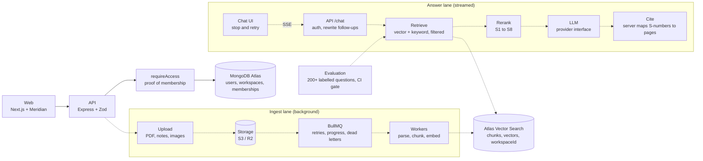

# Atlas AI

A private knowledge copilot: upload your documents, ask questions, and get streamed answers with citations you
can check.

Built by [Yashwanth Varma](https://github.com/yashwanthvarma74-ai) with the
[Meridian design system](https://github.com/yashwanthvarma74-ai/designSystem).

> **Status: week 1 of 6 (foundations).** Accounts, workspaces, roles and the tenant-isolation layer are built and
> tested. Uploading, retrieval, chat, evals and agents are **not built yet**; they are listed below so the
> architecture is clear, and each is marked with the week it lands. It is **not deployed** and the **demo video is
> not recorded**.

## Try it

You need Node 22+ and MongoDB running locally (`brew tap mongodb/brew && brew install mongodb-community`).

```bash
cp .env.example .env
npm install
npm run dev      # web http://localhost:3002, API http://localhost:4002
```

Open <http://localhost:3002> and press **Continue as guest**: no sign-up, and you land in a workspace you own. Create
a second account, add it to your workspace by email, and watch what a viewer can and cannot do.

```bash
npm test                 # unit, integration and component tests (needs MongoDB)
npm run test:coverage    # coverage for core and the API
npm run lint && npm run typecheck
```

## Architecture

The target system. The parts drawn dashed are not built yet.



Solid lines exist today. Everything that touches a workspace's data goes through `requireAccess`
([ADR 0001](docs/adr/0001-workspace-access-is-proved-by-a-type.md)).

### How a question becomes a cited answer (planned, weeks 3 and 4)

1. The UI shows your message instantly and opens a Server-Sent Events stream.
2. The API rewrites a follow-up ("what about 2025?") into a standalone question.
3. Hybrid retrieval runs vector and keyword search with a `workspaceId` filter that server code adds, never the model.
4. Results are merged with reciprocal rank fusion, reranked and numbered S1 to S8.
5. The model answers from those sources only and cites them by number while tokens stream to the browser.
6. The server maps each number to its stored page and passage, drops unknown ones, and logs tokens, latency and cost.

## What is built

| Week | Phase      | State                                                                                                                                  |
| ---- | ---------- | -------------------------------------------------------------------------------------------------------------------------------------- |
| 1    | Foundation | **Done.** Accounts, guest login, sessions, workspaces, three roles, member management, threat model, three ADRs, CI, design-system UI. |
| 2    | Ingest     | Not started. Storage, BullMQ queue, parsing, chunking, embeddings, live status.                                                        |
| 3    | Retrieval  | Not started. Hybrid search, tenant filter, citations.                                                                                  |
| 4    | Chat       | Not started. Streaming, stop and retry, history, sharing.                                                                              |
| 5    | Measure    | Not started. Eval harness, red-team cases, cost tracking, tool approval.                                                               |
| 6    | Show       | Not started. Hardening, deploy, benchmark report, demo video.                                                                          |

### Week 1 in numbers

Measured on the development laptop (macOS, Node 22, a local MongoDB 9.0 on the default port). Reproduce with
`npm run test:coverage`.

| What              | Result                                               |
| ----------------- | ---------------------------------------------------- |
| Tests             | 77 passing (shared 10, core 26, API 33, web 8)       |
| Coverage, core    | 93% statements, 76% branches                         |
| Coverage, API     | 97% statements, 85% branches                         |
| Strict TypeScript | `noUncheckedIndexedAccess`, no `any` (lint-enforced) |

## Repository

```
atlas-ai/
├─ apps/
│  ├─ web/          Next.js frontend, built from @yashwanthvarma74/react
│  └─ api/          Express API (a worker app joins it in week 2)
├─ packages/
│  ├─ shared/       types and Zod schemas used by both sides
│  └─ core/         data model, access control, accounts, workspaces
├─ docs/
│  ├─ adr/          decision records
│  └─ THREAT-MODEL.md
└─ .github/         CI and Dependabot
```

## Key decisions

- [0001. Workspace access is proved by a type, not remembered by each route](docs/adr/0001-workspace-access-is-proved-by-a-type.md)
- [0002. Build the UI with the design system](docs/adr/0002-build-the-ui-with-the-design-system.md)
- [0003. Accounts, sessions and guests](docs/adr/0003-accounts-and-sessions.md)

The threat model is in [docs/THREAT-MODEL.md](docs/THREAT-MODEL.md).

## Open question for week 3

Atlas Vector Search needs a MongoDB Atlas cluster or the `mongodb-atlas-local` image. A plain local `mongod` does
not run `$vectorSearch`. The choice (Atlas free tier, or the local image for development with Atlas for the demo)
is recorded as an ADR when the retrieval phase starts.
