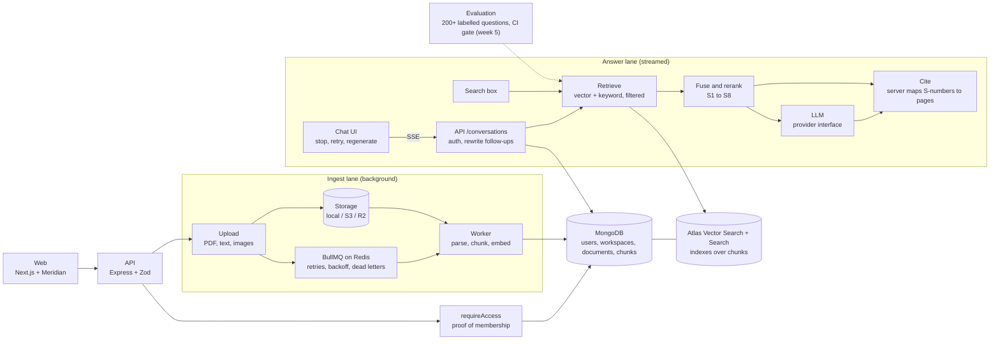

# Atlas AI

A private knowledge copilot: upload your documents, ask questions, and get streamed answers with citations you
can check.

Built by [Yashwanth Varma](https://github.com/yashwanthvarma74-ai) with the
[Meridian design system](https://github.com/yashwanthvarma74-ai/designSystem).

> **Status: all six weeks built; not deployed.** Accounts, workspaces, ingest, hybrid search, streaming cited chat,
> an evaluation gate, a tool-approval flow and a red-team suite are built and tested, and the whole stack runs in
> containers (`docker compose --profile app up`). There is **no live link and no recorded demo video**
> ([how it deploys](docs/DEPLOY.md), [the script](docs/DEMO-SCRIPT.md)). The hosted model providers have **not been run
> against their live services**, and every number comes from an offline embedder and answer model: read
> [docs/EVALUATION.md](docs/EVALUATION.md) and [docs/BENCHMARKS.md](docs/BENCHMARKS.md) before quoting one.

## The short version

| Question                               | Answer                                                                                | Where                                                                                                   |
| -------------------------------------- | ------------------------------------------------------------------------------------- | ------------------------------------------------------------------------------------------------------- |
| Does retrieval find the right passage? | recall@10 about 89% on 276 generated questions; the 0.90 target is not met            | [EVALUATION](docs/EVALUATION.md)                                                                        |
| Can one workspace see another's text?  | 0 cross-workspace retrievals, with each search stage attacked on its own              | [ADR 0008](docs/adr/0008-hybrid-retrieval-and-the-tenant-filter.md)                                     |
| Can the model act on its own?          | No: it can only propose, a person approves, everything is audited                     | [ADR 0014](docs/adr/0014-the-assistant-proposes-and-a-person-approves.md), [RED-TEAM](docs/RED-TEAM.md) |
| How fast?                              | search about 976 req/s, chat about 523 req/s on a laptop, zero errors (offline model) | [BENCHMARKS](docs/BENCHMARKS.md)                                                                        |
| What is promised?                      | [SLOs](docs/SLOS.md)                                                                  |                                                                                                         |
| The story                              | [case study](docs/case-study.md)                                                      |                                                                                                         |

## Try it

You need Node 22+ and Docker. `docker compose up -d` starts MongoDB with Atlas Search and Vector Search (the
`mongodb-atlas-local` image, on port 27018) and Redis. A plain `mongod` also works for everything except searching.

```bash
cp .env.example .env
npm install
npm run dev      # web http://localhost:3002, API http://localhost:4002, and the ingest worker
```

Or everything in containers, with no Node needed:

```bash
JWT_SECRET=$(openssl rand -base64 48) docker compose --profile app up --build
```

```bash

```

Open <http://localhost:3002> and press **Continue as guest**: no sign-up, and you land in a workspace you own. Open
it, upload a PDF, a text or Markdown file, or a PNG or JPEG, and watch it move from queued through parsing and
embedding to indexed. Create a second account, add it to your workspace by email, and watch what a viewer can and
cannot do.

Then open **Conversations** and ask a question. The answer streams in, cites its sources as `S1`, `S2`, ..., and each
citation opens the exact page's passages with the cited one marked. **Stop** keeps what had arrived, **Regenerate**
writes it again, a follow-up like "and costs?" is rewritten into a question that stands alone before it is
searched, and **Share with workspace** lets your colleagues read (not add to) a conversation. The **Search** box
under the documents finds passages directly.

By default passages are embedded with `EMBEDDING_PROVIDER=hash`, which needs no service and no key but matches on
shared words only, not meaning. That is enough to run and test the whole pipeline, and the search code is tested
for meaning with a stand-in embedder that groups synonyms. For real semantic search set `ollama` (local) or
`openai` in `.env`, and see `.env.example`.

The model that writes answers is `LLM_PROVIDER=extractive` by default: it answers by quoting the passages it is given,
so the whole chat works with no key and no service, but it cannot reason or paraphrase. Set `openai`, `anthropic` or
`ollama` for real answers. `EXTRACTIVE_DELAY_MS=40` slows it down so streaming is visible.

```bash
npm test                 # unit, integration and component tests (needs MongoDB)
npm run test:coverage    # coverage for core and the API
npm run lint && npm run typecheck
```

## Architecture

The target system. The parts drawn dashed are not built yet.



Solid lines exist today. Everything that touches a workspace's data goes through `requireAccess`
([ADR 0001](docs/adr/0001-workspace-access-is-proved-by-a-type.md)). Chunks and their vectors are already stored
with their `workspaceId`, and the search indexes filter on it inside the query.

### From upload to indexed (built)

1. The API checks the caller's editor role, reads the first bytes to decide what the file is, stores it, records the
   document as `queued` and queues a job. It answers `202`.
2. The worker re-checks that the uploader still has access, then parses the file page by page (PDF text, a text
   file, or OCR for an image).
3. Each page is split at paragraph, sentence and word boundaries into chunks that never cross a page
   ([ADR 0005](docs/adr/0005-chunking-by-structure-with-overlap.md)).
4. The chunks are embedded in batches and stored with their page, workspace and vector, replacing any earlier
   attempt. The document becomes `indexed`, or `failed` with a reason the user can act on.
5. The web app polls while anything is in progress, so the status moves on screen without a refresh.

### How a question becomes a cited answer (built)

1. The UI shows your message instantly and opens a Server-Sent Events stream.
2. The API rewrites a follow-up ("what about 2025?") into a standalone question.
3. Hybrid retrieval runs vector and keyword search with a `workspaceId` filter that server code adds, never the model.
4. Results are merged with reciprocal rank fusion, reranked and numbered S1 to S8.
5. The model answers from those sources only and cites them by number while tokens stream to the browser.
6. The server maps each number to its stored page and passage, drops unknown ones, and logs tokens, latency and cost.

## What is built

| Week | Phase      | State                                                                                                                                                                                                                                 |
| ---- | ---------- | ------------------------------------------------------------------------------------------------------------------------------------------------------------------------------------------------------------------------------------- |
| 1    | Foundation | **Done.** Accounts, guest login, sessions, workspaces, three roles, member management, threat model, three ADRs, CI, design-system UI.                                                                                                |
| 2    | Ingest     | Not started. Storage, BullMQ queue, parsing, chunking, embeddings, live status.                                                                                                                                                       |
| 3    | Retrieval  | Not started. Hybrid search, tenant filter, citations.                                                                                                                                                                                 |
| 4    | Chat       | **Done.** Streaming over SSE, Stop that saves the partial answer, Regenerate and Retry, follow-up rewriting, saved and searchable history, sharing with the workspace, time to first word shown, safe Markdown with error boundaries. |
| 5    | Measure    | **Mostly done.** Benchmark of 276 questions, scored runs and a CI gate, an evaluation dashboard, cost per answer, tool approval with an audit trail, a red-team suite. Not yet: a real-model run, an LLM judge, the benchmark report. |
| 6    | Show       | **Mostly done.** Images and a one-command stack (run end to end), security headers, a load test and benchmark report, SLOs, deploy guide, case study, demo script. **Not done:** a hosted deployment and the recorded video.          |     |

### Numbers

Measured on the development laptop (macOS, Node 22, MongoDB Atlas Local 8.3, Redis 8). Reproduce with
`docker compose up -d` and `npm run test:coverage`. No performance numbers are published yet: ingest and search
latency are measured in the week 6 benchmark against a real embedding model, because the hash embedder would
flatter them.

| What                 | Result                                                                                                             |
| -------------------- | ------------------------------------------------------------------------------------------------------------------ |
| Tests                | 479 passing against Atlas Local (shared 34, core 287, API 83, web 66, eval 9); 4 more run in CI against an S3 mock |
| Without Atlas Search | 319 pass and the 40 search tests are skipped, never faked, on a plain `mongod`                                     |
| Coverage, core       | 93% statements, 86% branches                                                                                       |
| Coverage, API        | 96% statements, 88% branches                                                                                       |
| Cross-workspace hits | 0, in the adversarial suite (each search stage alone, 9 attack queries, 40 random property runs)                   |
| Streaming            | 20 chunks over 1.1 s through the Next proxy (extractive model at 60 ms a word), uncompressed                       |
| Strict TypeScript    | `noUncheckedIndexedAccess`, no `any` (lint-enforced)                                                               |

The streaming row measures the transport, not a model: it proves words arrive as they are written and are not held
back. Time to first word, tokens and total time are recorded on every saved answer, and published against a real
model with the benchmark in week 5 and 6.

Search tests need `SEARCH_TEST_URL` (for example `mongodb://127.0.0.1:27018` with `docker compose up -d`). The
full suite ran 5 times in a row without a failure after the index wait was fixed. The two flakes found on the way, and
what caused them, are written up in [ADR 0007](docs/adr/0007-atlas-search-on-atlas-local.md) and
[ADR 0008](docs/adr/0008-hybrid-retrieval-and-the-tenant-filter.md).

Known gaps in what the tests cover: the real Tesseract OCR path and the S3 driver's signed links are exercised
by hand and in CI (S3), not in the default local test run. `parse.ts` is the least covered module (76%) for that
reason. The CI workflow itself has not been run: I cannot start GitHub Actions from here.

## Repository

```
atlas-ai/
├─ apps/
│  ├─ web/          Next.js frontend, built from @yashwanthvarma74/react
│  ├─ api/          Express API
│  └─ worker/       BullMQ worker: parse, chunk, embed
├─ packages/
│  ├─ shared/       types and Zod schemas used by both sides
│  └─ core/         data model, access control, accounts, workspaces,
│                    documents, queue, parsing, chunking, embeddings, storage
├─ docs/
│  ├─ adr/          decision records
│  └─ THREAT-MODEL.md
└─ .github/         CI and Dependabot
```

## Key decisions

- [0001. Workspace access is proved by a type, not remembered by each route](docs/adr/0001-workspace-access-is-proved-by-a-type.md)
- [0002. Build the UI with the design system](docs/adr/0002-build-the-ui-with-the-design-system.md)
- [0003. Accounts, sessions and guests](docs/adr/0003-accounts-and-sessions.md)
- [0004. Ingest is a queue of idempotent jobs](docs/adr/0004-ingest-is-a-queue-of-idempotent-jobs.md)
- [0005. Chunking by structure, with a little overlap](docs/adr/0005-chunking-by-structure-with-overlap.md)
- [0006. Uploads are untrusted bytes](docs/adr/0006-uploads-are-untrusted-bytes.md)
- [0007. Atlas Vector Search and Atlas Search, developed on Atlas Local](docs/adr/0007-atlas-search-on-atlas-local.md)
- [0008. Hybrid retrieval, and a tenant filter that is tested at every layer](docs/adr/0008-hybrid-retrieval-and-the-tenant-filter.md)
- [0009. Citations are owned by the server](docs/adr/0009-citations-are-owned-by-the-server.md)
- [0010. Answers stream over Server-Sent Events, and Stop means "save what you have"](docs/adr/0010-answers-stream-over-sse-and-stop-means-save.md)
- [0011. Conversations are private until their author shares them](docs/adr/0011-conversations-are-private-until-shared.md)
- [0013. Quality is a number, and a change that lowers it does not merge](docs/adr/0013-quality-is-a-number-and-a-gate.md)
- [0014. The assistant proposes, and a person approves](docs/adr/0014-the-assistant-proposes-and-a-person-approves.md)
- [0015. Containers, and the hardening that came with them](docs/adr/0015-containers-and-hardening.md)
- [0012. The model is behind an interface, and everything it sees or says is untrusted](docs/adr/0012-the-model-is-behind-an-interface-and-everything-it-sees-or-says-is-untrusted.md)

The threat model is in [docs/THREAT-MODEL.md](docs/THREAT-MODEL.md).

## Evaluation results (offline embedder and model)

Recall@10 is about **89%** on the benchmark (88.7% to 89.2% between runs, because the vector search is approximate; 92% for questions in the document's words, 86% paraphrased), MRR 0.63, with
**0** cross-workspace retrievals. The 0.90 target is not met. Before tuning it was 71.7%; the chunk size, overlap and
reranker were chosen from a sweep ([EVALUATION.md](docs/EVALUATION.md)). A relevance cutoff was tried and does not
help. Citation consistency is 100% but means little for a model that only quotes. The red-team cases are in
[docs/RED-TEAM.md](docs/RED-TEAM.md). Run it: `docker compose up -d`, then `npm run eval`.

## What is left, and it is not code

A hosted deployment with a live link and one-click guest login, the recorded demo video, a run with a real embedder and
model (which will change every number above), and cleaning up idle guest accounts for a public demo.

## Known limits of week 5

- **Not met:** recall@10 0.90; and no real model or embedder has been measured. The harness records which was used.
- **Answerability** (saying "the documents do not say") is the model's job and is unmeasured without one.
- **Tool approval covers one tool** that writes a note; more tools need their own review.
- **The CI workflow, including the evaluation step, has not been run.**

## Known limits of week 4

- **The hosted model providers (OpenAI, Anthropic, Ollama) are untested against their live services.** Their request
  and stream formats are tested against fixtures in each provider's documented shape. Gemini is not implemented.
- **Retrieval quality and answer quality are not measured yet.** There is no labelled question set until week 5, and
  the default embedder and model have no sense of meaning. Nothing here claims a score.
- **No relevance cutoff.** Search always returns the nearest passages, so an unanswerable question still gets
  results ([ADR 0008](docs/adr/0008-hybrid-retrieval-and-the-tenant-filter.md)). The cutoff is calibrated in week 5.
- **A citation is checked to exist, not to support its sentence.** That is the citation-accuracy metric in week 5.
- **No agents or tool calls yet** (week 5).
- **Switching embedding model needs a re-index.** The vector index is built for one dimension count.
- **The CI workflow has not been run**, and the context view shows a page's stored passages, not the rendered PDF page.
