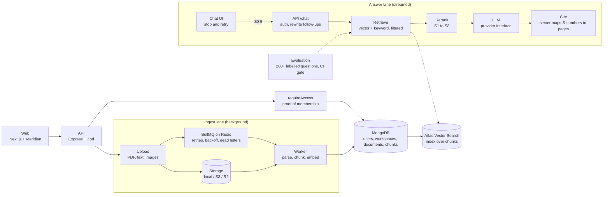

# Atlas AI

A private knowledge copilot: upload your documents, ask questions, and get streamed answers with citations you
can check.

Built by [Yashwanth Varma](https://github.com/yashwanthvarma74-ai) with the
[Meridian design system](https://github.com/yashwanthvarma74-ai/designSystem).

> **Status: week 2 of 6 (ingest).** Accounts, workspaces, roles, tenant isolation and the upload-to-indexed
> pipeline are built and tested. Retrieval, chat, evals and agents are **not built yet**; they are drawn dashed
> below and each is marked with the week it lands. It is **not deployed** and the **demo video is not recorded**.

## Try it

You need Node 22+, MongoDB and Redis running locally (`brew install redis` and
`brew tap mongodb/brew && brew install mongodb-community` on a Mac), or `docker compose up -d` for both.

```bash
cp .env.example .env
npm install
npm run dev      # web http://localhost:3002, API http://localhost:4002, and the ingest worker
```

Open <http://localhost:3002> and press **Continue as guest**: no sign-up, and you land in a workspace you own. Open
it, upload a PDF, a text or Markdown file, or a PNG or JPEG, and watch it move from queued through parsing and
embedding to indexed. Create a second account, add it to your workspace by email, and watch what a viewer can and
cannot do.

By default passages are embedded with `EMBEDDING_PROVIDER=hash`, which needs no service and no key but matches on
shared words only, not meaning. That is enough to run and test the whole pipeline. For real answers (week 3
onward) set `ollama` (local) or `openai` in `.env`; see `.env.example`.

```bash
npm test                 # unit, integration and component tests (needs MongoDB)
npm run test:coverage    # coverage for core and the API
npm run lint && npm run typecheck
```

## Architecture

The target system. The parts drawn dashed are not built yet.



Solid lines exist today. Everything that touches a workspace's data goes through `requireAccess`
([ADR 0001](docs/adr/0001-workspace-access-is-proved-by-a-type.md)). Chunks and their vectors are already stored
with their `workspaceId`; week 3 puts the search index on top of them.

### From upload to indexed (built)

1. The API checks the caller's editor role, reads the first bytes to decide what the file is, stores it, records the
   document as `queued` and queues a job. It answers `202`.
2. The worker re-checks that the uploader still has access, then parses the file page by page (PDF text, a text
   file, or OCR for an image).
3. Each page is split at paragraph, sentence and word boundaries into chunks that never cross a page
   ([ADR 0005](docs/adr/0005-chunking-by-structure-with-overlap.md)).
4. The chunks are embedded in batches and stored with their page, workspace and vector, replacing any earlier
   attempt. The document becomes `indexed`, or `failed` with a reason the user can act on.
5. The web app polls while anything is in progress, so the status moves on screen without a refresh.

### How a question becomes a cited answer (planned, weeks 3 and 4)

1. The UI shows your message instantly and opens a Server-Sent Events stream.
2. The API rewrites a follow-up ("what about 2025?") into a standalone question.
3. Hybrid retrieval runs vector and keyword search with a `workspaceId` filter that server code adds, never the model.
4. Results are merged with reciprocal rank fusion, reranked and numbered S1 to S8.
5. The model answers from those sources only and cites them by number while tokens stream to the browser.
6. The server maps each number to its stored page and passage, drops unknown ones, and logs tokens, latency and cost.

## What is built

| Week | Phase      | State                                                                                                                                  |
| ---- | ---------- | -------------------------------------------------------------------------------------------------------------------------------------- |
| 1    | Foundation | **Done.** Accounts, guest login, sessions, workspaces, three roles, member management, threat model, three ADRs, CI, design-system UI. |
| 2    | Ingest     | Not started. Storage, BullMQ queue, parsing, chunking, embeddings, live status.                                                        |
| 3    | Retrieval  | Not started. Hybrid search, tenant filter, citations.                                                                                  |
| 4    | Chat       | Not started. Streaming, stop and retry, history, sharing.                                                                              |
| 5    | Measure    | Not started. Eval harness, red-team cases, cost tracking, tool approval.                                                               |
| 6    | Show       | Not started. Hardening, deploy, benchmark report, demo video.                                                                          |

### Numbers

Measured on the development laptop (macOS, Node 22, local MongoDB 9.0 and Redis 8). Reproduce with
`npm run test:coverage`. No performance numbers are published yet: ingest throughput is measured with the benchmark
report in week 6, against a real embedding model, because the hash embedder would flatter it.

| What              | Result                                                                                 |
| ----------------- | -------------------------------------------------------------------------------------- |
| Tests             | 173 passing, 4 more run in CI against an S3 mock (shared 10, core 102, API 45, web 16) |
| Coverage, core    | 91% statements, 82% branches                                                           |
| Coverage, API     | 97% statements, 85% branches                                                           |
| Strict TypeScript | `noUncheckedIndexedAccess`, no `any` (lint-enforced)                                   |

Known gaps in what the tests cover: the real Tesseract OCR path and the S3 driver's signed links are exercised
by hand and in CI (S3), not in the default local test run. `parse.ts` is the least covered module (76%) for that
reason.

## Repository

```
atlas-ai/
├─ apps/
│  ├─ web/          Next.js frontend, built from @yashwanthvarma74/react
│  ├─ api/          Express API
│  └─ worker/       BullMQ worker: parse, chunk, embed
├─ packages/
│  ├─ shared/       types and Zod schemas used by both sides
│  └─ core/         data model, access control, accounts, workspaces,
│                    documents, queue, parsing, chunking, embeddings, storage
├─ docs/
│  ├─ adr/          decision records
│  └─ THREAT-MODEL.md
└─ .github/         CI and Dependabot
```

## Key decisions

- [0001. Workspace access is proved by a type, not remembered by each route](docs/adr/0001-workspace-access-is-proved-by-a-type.md)
- [0002. Build the UI with the design system](docs/adr/0002-build-the-ui-with-the-design-system.md)
- [0003. Accounts, sessions and guests](docs/adr/0003-accounts-and-sessions.md)
- [0004. Ingest is a queue of idempotent jobs](docs/adr/0004-ingest-is-a-queue-of-idempotent-jobs.md)
- [0005. Chunking by structure, with a little overlap](docs/adr/0005-chunking-by-structure-with-overlap.md)
- [0006. Uploads are untrusted bytes](docs/adr/0006-uploads-are-untrusted-bytes.md)

The threat model is in [docs/THREAT-MODEL.md](docs/THREAT-MODEL.md).

## Open question for week 3

Atlas Vector Search needs a MongoDB Atlas cluster or the `mongodb-atlas-local` image. A plain local `mongod` does
not run `$vectorSearch`. The choice (Atlas free tier, or the local image for development with Atlas for the demo)
is recorded as an ADR when the retrieval phase starts.
